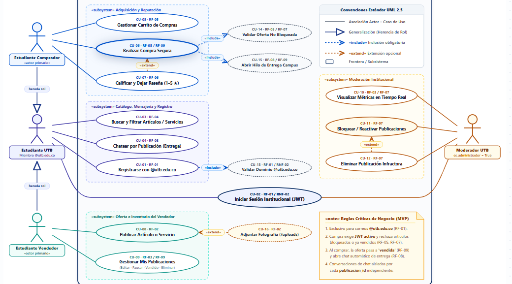
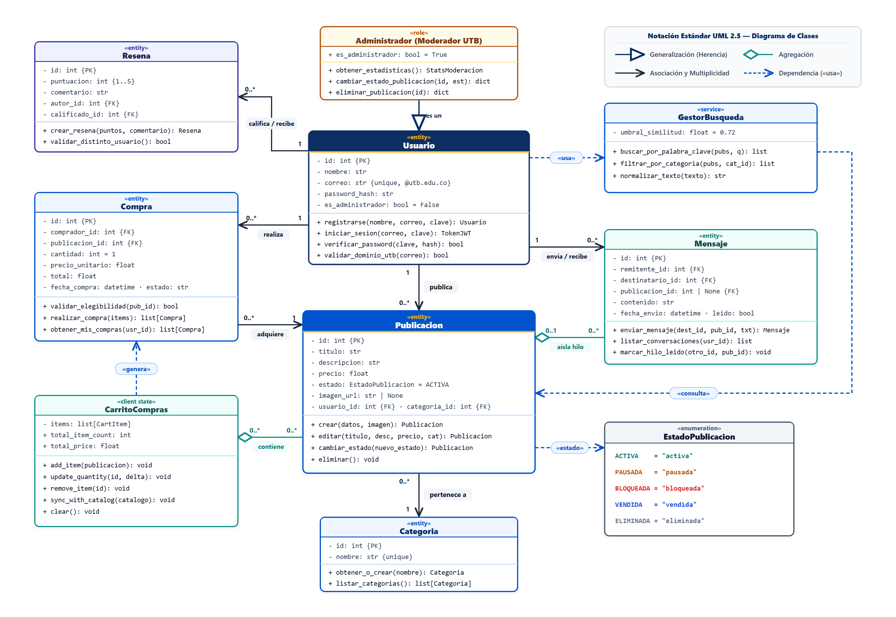
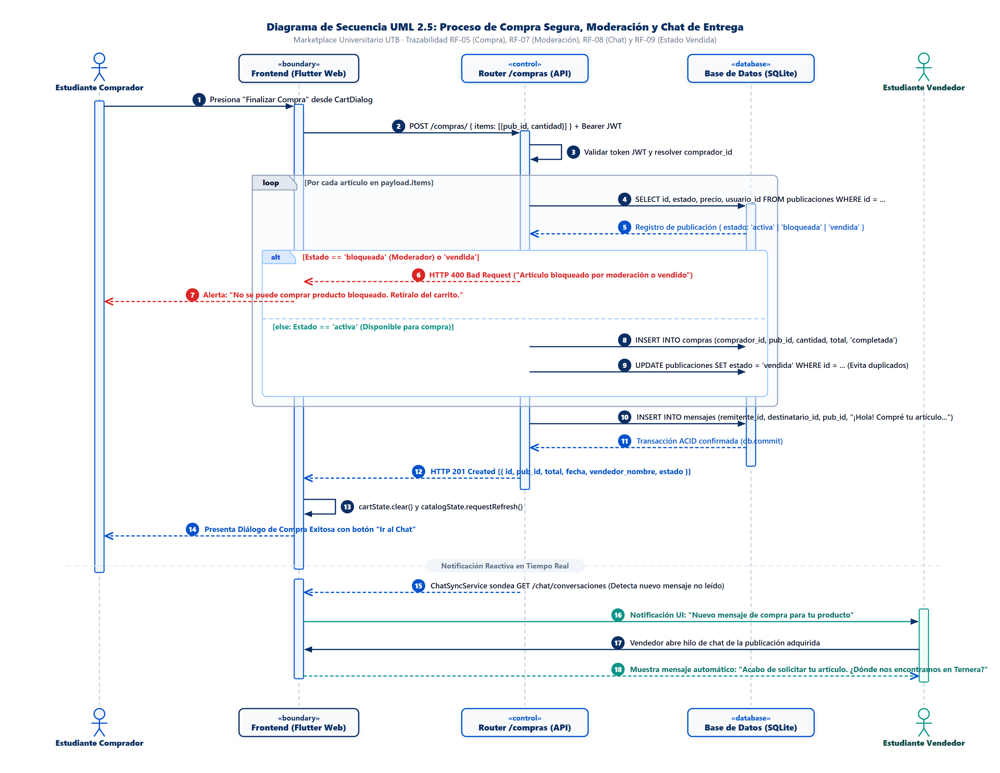
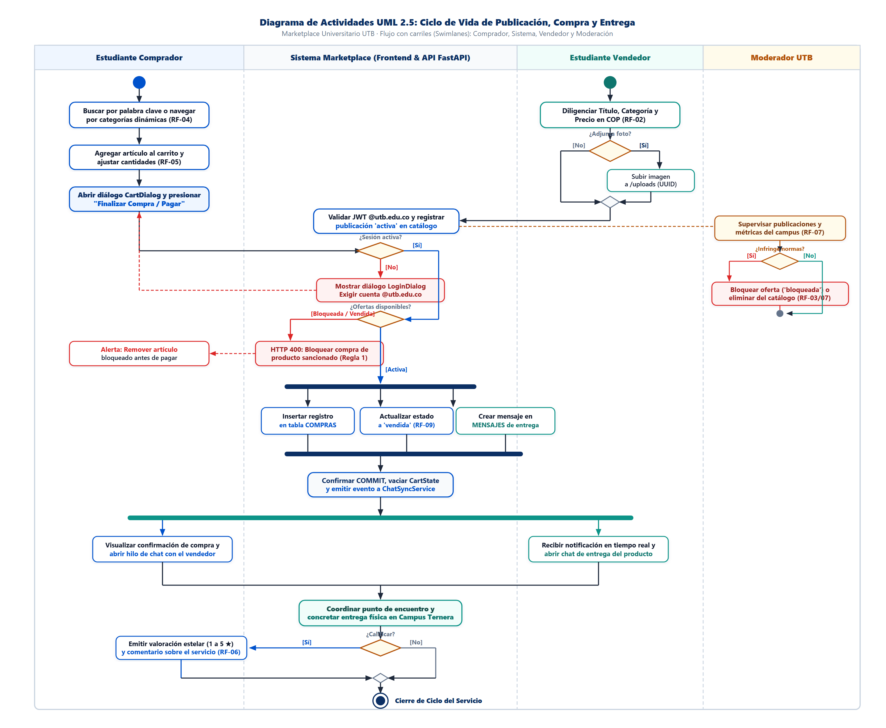
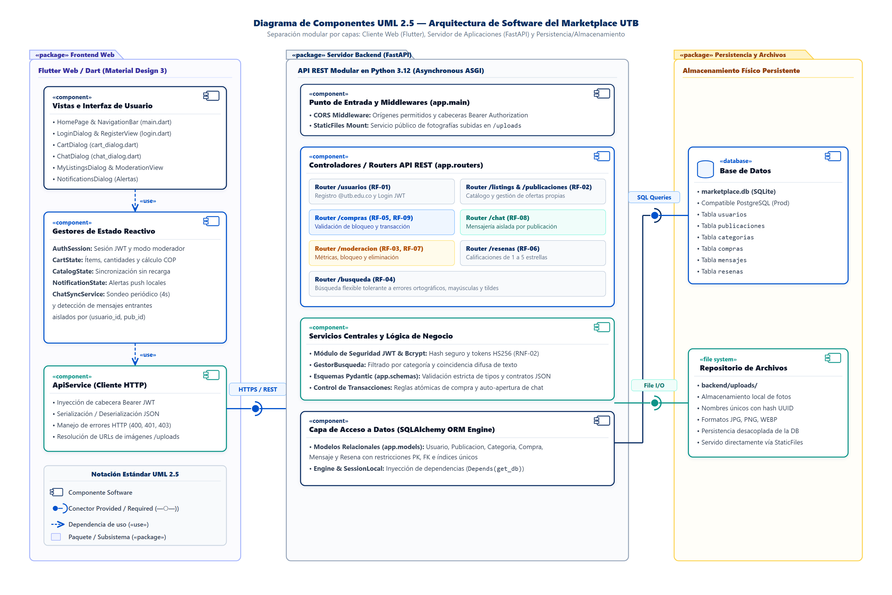
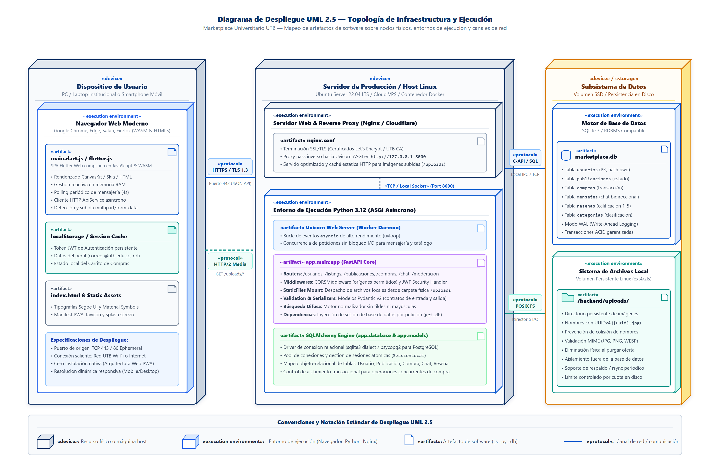

# Documentación de Arquitectura y Diagramas UML 2.5 — Marketplace Universitario UTB

Este documento describe de forma detallada el modelado funcional, estructural, comportamental, modular y de infraestructura de la plataforma **Marketplace Universitario UTB**, conforme al estándar **UML 2.5** y haciendo referencia directa a las imágenes de alta resolución almacenadas en el directorio [`./renders/`](./renders/).

---

## Índice de Diagramas y Matriz de Trazabilidad

| # | Diagrama UML 2.5 | Archivo en `renders/` | Requerimientos Asociados | Módulos Principales Relacionados |
| :-: | :--- | :--- | :--- | :--- |
| **1** | [Diagrama de Casos de Uso (UML 2.5)](#1-diagrama-de-casos-de-uso-uml-25) | [`diagrama_casos_de_usos.png`](./renders/diagrama_casos_de_usos.png) | `RF-01` a `RF-09`, `RNF-02` | Todos los routers API (`backend/app/routers/`) y vistas en `frontend/lib/` |
| **2** | [Diagrama de Clases (UML 2.5)](#2-diagrama-de-clases-uml-25) | [`diagrama_clases.png`](./renders/diagrama_clases.png) | `RF-01` a `RF-09`, `RNF-02` | `backend/app/models/`, `backend/app/schemas/`, `frontend/lib/models/` |
| **3** | [Secuencia: Compra Segura, Moderación y Chat](#3-diagrama-de-secuencia-compra-segura-moderación-y-chat-de-entrega) | [`diagrama_secuencia.png`](./renders/diagrama_secuencia.png) | `RF-05`, `RF-07`, `RF-08`, `RF-09` | `backend/app/routers/compras.py`, `chat.py`, `cart_dialog.dart`, `chat_dialog.dart` |
| **4** | [Actividades: Publicación, Compra y Entrega](#4-diagrama-de-actividades-ciclo-de-vida-de-publicación-compra-y-entrega) | [`diagrama_actividades.png`](./renders/diagrama_actividades.png) | `RF-01` a `RF-09` | `publicaciones.py`, `compras.py`, `moderacion.py`, `resenas.py`, `main.dart` |
| **5** | [Componentes: Arquitectura Modular en Capas](#5-diagrama-de-componentes-arquitectura-modular-de-software) | [`diagrama_componentes.png`](./renders/diagrama_componentes.png) | `RNF-01`, `RNF-02`, `RNF-03` | `frontend/lib/`, `backend/app/main.py`, `backend/app/database.py`, `backend/uploads/` |
| **6** | [Despliegue: Topología de Infraestructura](#6-diagrama-de-despliegue-topología-de-infraestructura-y-ejecución) | [`diagrama_despliegue.png`](./renders/diagrama_despliegue.png) | `RNF-01`, `RNF-02`, `RNF-03` | Cliente Web PWA, Servidor Host Linux (Nginx + Uvicorn/FastAPI), SQLite & Volumen SSD |

---

## 1. Diagrama de Casos de Uso (UML 2.5)

> **Archivo fuente de imagen:** [`renders/diagrama_casos_de_usos.png`](./renders/diagrama_casos_de_usos.png)

### Actores, Jerarquía de Roles y Subsistemas Funcionales
El diagrama delimita el alcance funcional del **MVP del Marketplace Universitario UTB** empleando generalización de actores (`◁──`), subsistemas (`«subsystem»`) y relaciones estereotipadas (`«include»` y `«extend»`):

1. **Jerarquía de Actores Institucionales:**
   - **`Estudiante UTB` (`Miembro @utb.edu.co`):** Actor base autenticado dentro de la comunidad universitaria.
   - **`Estudiante Comprador` (`«actor primario»`):** Especializa y hereda las capacidades de `Estudiante UTB` para adquirir productos/servicios y evaluar oferentes.
   - **`Estudiante Vendedor` (`«actor primario»`):** Especializa y hereda el rol de `Estudiante UTB` para ofertar artículos/servicios y administrar su inventario propio.
   - **`Moderador UTB` (`es_administrador = True`):** Actor administrativo encargado de la gobernanza, supervisión de métricas y control de contenido infractor.

2. **Subsistemas y Casos de Uso (`CU-01` a `CU-16`):**
   - **Autenticación Transversal:**
     - `CU-02 · RF-01 / RNF-02` — *Iniciar Sesión Institucional (JWT)*: Caso de uso compartido tanto por `Estudiante UTB` como por `Moderador UTB`.
   - **`«subsystem» Catálogo, Mensajería y Registro`:**
     - `CU-01 · RF-01` — *Registrarse con `@utb.edu.co`*: Incluye obligatoriamente (`«include»`) a `CU-13 · RF-01 / RNF-02` (*Validar Dominio `@utb.edu.co`*).
     - `CU-03 · RF-04` — *Buscar y Filtrar Artículos / Servicios* por categoría o coincidencia flexible de texto.
     - `CU-04 · RF-08` — *Chatear por Publicación (Entrega)* mediante hilos independientes aislados por oferta.
   - **`«subsystem» Adquisición y Reputación`:**
     - `CU-05 · RF-05` — *Gestionar Carrito de Compras* (agregar ítems, modificar cantidades, calcular total en COP).
     - `CU-06 · RF-05 / RF-09` — *Realizar Compra Segura*: Incluye obligatoriamente (`«include»`) la validación `CU-14 · RF-05 / RF-07` (*Validar Oferta No Bloqueada*) y `CU-15 · RF-08 / RF-09` (*Abrir Hilo de Entrega Campus*).
     - `CU-07 · RF-06` — *Calificar y Dejar Reseña (1–5 ★)*: Extiende opcionalmente (`«extend»`) el cierre de una compra (`CU-06`).
   - **`«subsystem» Oferta e Inventario del Vendedor`:**
     - `CU-08 · RF-02` — *Publicar Artículo o Servicio*: Extendido opcionalmente (`«extend»`) por `CU-16 · RF-02` (*Adjuntar Fotografía `/uploads`*).
     - `CU-09 · RF-03 / RF-09` — *Gestionar Mis Publicaciones (Editar · Pausar · Vendido · Eliminar)*.
   - **`«subsystem» Moderación Institucional`:**
     - `CU-10 · RF-03 / RF-07` — *Visualizar Métricas en Tiempo Real* del campus.
     - `CU-11 · RF-07` — *Bloquear / Reactivar Publicaciones* reportadas o infractoras.
     - `CU-12 · RF-07` — *Eliminar Publicación Infractora* de forma permanente (`«extend»` sobre `CU-11`).

---

## 2. Diagrama de Clases (UML 2.5)

> **Archivo fuente de imagen:** [`renders/diagrama_clases.png`](./renders/diagrama_clases.png)

### Modelo Estructural de Dominio, Estado Cliente y Servicios
El diagrama representa las clases persistentes (`«entity»`), roles especializados (`«role»`), enumeraciones (`«enumeration»`), servicios de dominio (`«service»`) y gestores de estado en cliente (`«client state»`), especificando visibilidad (`+`, `-`), tipos de datos y multiplicidades exactas:

- **`«entity» Usuario` y `«role» Administrador (Moderador UTB)`:**
  - `Usuario` encapsula la identidad institucional (`id {PK}`, `nombre`, `correo {unique, @utb.edu.co}`, `password_hash`, `es_administrador`) junto con las operaciones de autenticación (`registrarse()`, `iniciar_sesion()`, `verificar_password()`, `validar_dominio_utb()`).
  - `Administrador` hereda (`es un ◁──`) de `Usuario` fijando `es_administrador = True` y habilitando operaciones de gobernanza (`obtener_estadisticas()`, `cambiar_estado_publicacion()`, `eliminar_publicacion()`).
- **`«entity» Publicacion`, `«entity» Categoria` y `«enumeration» EstadoPublicacion`:**
  - Un `Usuario` *publica* `0..*` instancias de `Publicacion`, y cada `Publicacion` *pertenece a* `1` `Categoria` (`0..* ── 1`).
  - `Publicacion` gestiona `titulo`, `descripcion`, `precio`, `imagen_url` y `estado`, tipado mediante la enumeración `EstadoPublicacion` (`ACTIVA`, `PAUSADA`, `BLOQUEADA`, `VENDIDA`, `ELIMINADA`).
- **`«entity» Compra` y `«client state» CarritoCompras`:**
  - `CarritoCompras` mantiene una relación de agregación (`◇── contiene 0..*`) sobre las publicaciones seleccionadas en el cliente (`add_item()`, `update_quantity()`, `sync_with_catalog()`, `clear()`) y mantiene una dependencia `«genera»` hacia `Compra`.
  - `Compra` vincula al comprador (`Usuario 1 ── 0..* realiza`) con la oferta adquirida (`Publicacion 1 ── 0..* adquiere`), validando elegibilidad previa (`validar_elegibilidad()`).
- **`«entity» Mensaje` y `«entity» Resena`:**
  - `Mensaje` relaciona emisor y receptor (`Usuario 1 ── 0..* envía / recibe`) y se asocia con `Publicacion` (`0..1 ── 0..* aísla hilo`) mediante `publicacion_id {FK}` para separar conversaciones independientes por producto.
  - `Resena` modela calificaciones estelares restringidas al rango `{1..5}` verificando que el autor no se autocalifique (`validar_distinto_usuario()`).
- **`«service» GestorBusqueda`:**
  - Servicio sin estado con `umbral_similitud: float = 0.72` utilizado (`«usa»`) por los usuarios para consultar (`«consulta»`) publicaciones mediante coincidencia difusa normalizada (`buscar_por_palabra_clave()`, `filtrar_por_categoria()`, `normalizar_texto()`).

---

## 3. Diagrama de Secuencia: Compra Segura, Moderación y Chat de Entrega

> **Archivo fuente de imagen:** [`renders/diagrama_secuencia.png`](./renders/diagrama_secuencia.png)

### Flujo de Interacción Temporal (`Pasos 1 al 18`)
Modela el protocolo cronológico entre **Estudiante Comprador**, **`«boundary» Frontend (Flutter Web)`**, **`«control» Router /compras (API)`**, **`«database» Base de Datos (SQLite)`** y **Estudiante Vendedor**:

1. **Solicitud Autenticada (`Pasos 1–3`):**
   - El comprador presiona *"Finalizar Compra"* en `CartDialog` (`Paso 1`).
   - El frontend envía `POST /compras/` adjuntando el arreglo `items: [{pub_id, cantidad}]` y la cabecera `Bearer JWT` (`Paso 2`).
   - El controlador valida la firma criptográfica del token JWT y resuelve el `comprador_id` (`Paso 3`).
2. **Validación Iterativa de Moderación y Disponibilidad (`Pasos 4–9`, fragmentos `loop` y `alt`):**
   - Para cada ítem del carrito se consulta `SELECT id, estado, precio, usuario_id FROM publicaciones` (`Pasos 4–5`).
   - **Caso rechazado (`[Estado == 'bloqueada' (Moderador) o 'vendida']`, `Pasos 6–7`):** El backend aborta la transacción con `HTTP 400 Bad Request` y la interfaz alerta al estudiante para retirar el artículo sancionado o agotado.
   - **Caso válido (`[else: Estado == 'activa']`, `Pasos 8–9`):** Se inserta el registro en `compras` con estado `'completada'` y se ejecuta `UPDATE publicaciones SET estado = 'vendida'` para impedir ventas duplicadas.
3. **Apertura Automática de Chat y Confirmación ACID (`Pasos 10–14`):**
   - El router inserta un mensaje inicial automático en la tabla `mensajes` vinculando `remitente_id`, `destinatario_id` y `publicacion_id` (`Paso 10`), confirma la transacción mediante `db.commit` (`Paso 11`) y retorna `HTTP 201 Created` (`Paso 12`).
   - El frontend limpia el carrito (`cartState.clear()`), refresca el catálogo (`catalogState.requestRefresh()`) y despliega el diálogo de éxito con acceso directo *"Ir al Chat"* (`Pasos 13–14`).
4. **Notificación Reactiva al Vendedor (`Pasos 15–18`):**
   - El servicio `ChatSyncService` detecta el nuevo mensaje no leído mediante sondeo periódico a `GET /chat/conversaciones` (`Paso 15`), dispara una alerta visual en tiempo real al **Estudiante Vendedor** (`Paso 16`) y habilita la coordinación inmediata del punto de encuentro en el Campus Ternera (`Pasos 17–18`).

---

## 4. Diagrama de Actividades: Ciclo de Vida de Publicación, Compra y Entrega

> **Archivo fuente de imagen:** [`renders/diagrama_actividades.png`](./renders/diagrama_actividades.png)

### Flujo de Proceso Multirrol con Carriles (*Swimlanes*)
Representa el proceso de negocio de extremo a extremo distribuido en **cuatro particiones de responsabilidad**:

1. **Carril `Estudiante Vendedor` (Creación de Oferta):**
   - Diligencia título, categoría y precio en pesos colombianos (`RF-02`).
   - Evalúa el nodo de decisión `¿Adjunta foto?`: si elige `[Sí]`, almacena la imagen con identificador único UUID en `/uploads`; en ambos casos converge para registrar la oferta en el sistema.
2. **Carril `Moderador UTB` (Gobernanza Concurrente):**
   - Supervisa de forma continua las publicaciones y métricas del campus (`RF-07`).
   - En la guarda `¿Infringe normas?`, si detecta incumplimiento (`[Sí]`), bloquea la publicación (`'bloqueada'`) o la elimina definitivamente del catálogo (`RF-03 / RF-07`).
3. **Carril `Estudiante Comprador` y `Sistema Marketplace (Frontend & API FastAPI)`:**
   - El comprador explora o filtra ofertas (`RF-04`), agrega ítems al carrito (`RF-05`) e inicia el pago desde `CartDialog`.
   - **Control de Sesión (`¿Sesión activa?`):** Si no existe token válido (`[No]`), despliega `LoginDialog` exigiendo credenciales `@utb.edu.co`.
   - **Control de Sanciones (`¿Ofertas disponibles?`):** Si algún producto está `[Bloqueada / Vendida]`, emite `HTTP 400` bloqueando la compra y notificando al comprador; si está `[Activa]`, ingresa a la barra de sincronización (*Fork*).
4. **Ejecución Transaccional Paralela y Cierre en Campus (*Fork / Join*):**
   - El sistema ejecuta atómicamente tres acciones concurrentes: *Insertar registro en tabla `COMPRAS`*, *Actualizar estado a `'vendida'` (`RF-09`)* y *Crear mensaje en `MENSAJES` de entrega*, consolidándolas en un `COMMIT` único que vacía `CartState`.
   - Posteriormente, comprador y vendedor reciben confirmación y notificación en paralelo para **coordinar el punto de encuentro y concretar la entrega física en el Campus Ternera**.
   - Finalmente, la decisión opcional `¿Calificar?` permite al comprador emitir una valoración de 1 a 5 estrellas y comentario (`RF-06`) antes de alcanzar el nodo final **Cierre de Ciclo del Servicio**.

---

## 5. Diagrama de Componentes: Arquitectura Modular de Software

> **Archivo fuente de imagen:** [`renders/diagrama_componentes.png`](./renders/diagrama_componentes.png)

### Organización en Paquetes, Componentes e Interfaces Provistas/Requeridas
El sistema se estructura en tres paquetes desacoplados (`«package»`) interconectados mediante conectores formales de ensamblaje UML 2.5 (*Lollipop / Socket* `—○—)`):

1. **`«package» Frontend Web` (`Flutter Web / Dart — Material Design 3`):**
   - **`«component» Vistas e Interfaz de Usuario`:** Agrupa `HomePage & NavigationBar (main.dart)`, `LoginDialog & RegisterView (login.dart)`, `CartDialog`, `ChatDialog`, `MyListingsDialog & ModerationView` y `NotificationsDialog`.
   - **`«component» Gestores de Estado Reactivo`:** Consumido vía `«use»` por las vistas; integra `AuthSession` (JWT y modo moderador), `CartState`, `CatalogState`, `NotificationState` y `ChatSyncService` (sondeo cada 4s aislado por `(usuario_id, pub_id)`).
   - **`«component» ApiService (Cliente HTTP)`:** Centraliza la inyección de cabeceras `Bearer JWT`, serialización JSON, manejo de códigos de error (`400`, `401`, `403`) y resolución de rutas multimedia `/uploads`. Consume la interfaz requerida **`HTTPS / REST`**.

2. **`«package» Servidor Backend (FastAPI)` (`Python 3.12 — Asynchronous ASGI`):**
   - **`«component» Punto de Entrada y Middlewares (app.main)`:** Configura `CORS Middleware` y monta `StaticFiles` sobre `/uploads`.
   - **`«component» Controladores / Routers API REST (app.routers)`:** Módulos especializados por dominio: `/usuarios (RF-01)`, `/listings & /publicaciones (RF-02)`, `/compras (RF-05, RF-09)`, `/chat (RF-08)`, `/moderacion (RF-03, RF-07)`, `/resenas (RF-06)` y `/busqueda (RF-04)`.
   - **`«component» Servicios Centrales y Lógica de Negocio`:** Módulo de Seguridad `JWT & Bcrypt` (`RNF-02`), `GestorBusqueda`, esquemas de validación `Pydantic (app.schemas)` y control atómico de transacciones.
   - **`«component» Capa de Acceso a Datos (SQLAlchemy ORM Engine)`:** Define los modelos relacionales (`app.models`) y administra sesiones transaccionales inyectadas mediante `Depends(get_db)`.

3. **`«package» Persistencia y Archivos` (`Almacenamiento Físico Persistente`):**
   - **`«database» Base de Datos`:** Expone la interfaz provista **`SQL Queries`** sobre `marketplace.db (SQLite)` (compatible con PostgreSQL en producción) alojando las tablas `usuarios`, `publicaciones`, `categorias`, `compras`, `mensajes` y `resenas`.
   - **`«file system» Repositorio de Archivos`:** Expone la interfaz provista **`File I/O`** sobre `backend/uploads/` para almacenar fotografías con hash UUID único en formatos `JPG`, `PNG` y `WEBP`.

---

## 6. Diagrama de Despliegue: Topología de Infraestructura y Ejecución

> **Archivo fuente de imagen:** [`renders/diagrama_despliegue.png`](./renders/diagrama_despliegue.png)

### Nodos Físicos, Entornos de Ejecución, Artefactos y Protocolos de Red
Describe la distribución física y de tiempo de ejecución del sistema a través de tres nodos tridimensionales (`«device»`), entornos anidados (`«execution environment»`) y artefactos desplegables (`«artifact»`):

1. **`«device» Dispositivo de Usuario` (`PC / Laptop Institucional o Smartphone Móvil`):**
   - **`«execution environment» Navegador Web Moderno` (`Chrome, Edge, Safari, Firefox — WASM & HTML5`):**
     - `«artifact» main.dart.js / flutter.js`: Aplicación SPA compilada con renderizado CanvasKit/HTML, estado reactivo en memoria RAM y cliente HTTP asíncrono sin requerir instalación nativa (arquitectura PWA).
     - `«artifact» localStorage / Session Cache`: Almacenamiento local del token JWT, datos del perfil `@utb.edu.co` y estado persistente del carrito.
     - `«artifact» index.html & Static Assets`: Hoja de entrada, tipografías institucionales, íconos Material Symbols y manifiesto web.
   - **Canales WAN hacia el Servidor:** `«protocol» HTTPS / TLS 1.3` sobre puerto `443` para consumo de la API JSON y `«protocol» HTTP/2 Media` (`GET /uploads/*`) para carga optimizada de imágenes.

2. **`«device» Servidor de Producción / Host Linux` (`Ubuntu Server 22.04 LTS / Cloud VPS / Contenedor Docker`):**
   - **`«execution environment» Servidor Web & Reverse Proxy (Nginx / Cloudflare)`:** Despliega `«artifact» nginx.conf` para terminación SSL/TLS, caché estática de `/uploads` y redirección inversa mediante `«TCP / Local Socket» (Port 8000)`.
   - **`«execution environment» Entorno de Ejecución Python 3.12 (ASGI Asíncrono)`:**
     - `«artifact» Uvicorn Web Server (Worker Daemon)`: Bucle de eventos `asyncio` de alta concurrencia sin bloqueo I/O.
     - `«artifact» app.main:app (FastAPI Core)`: Núcleo de routers REST, middlewares de seguridad, serializadores Pydantic v2 y motor de búsqueda difusa.
     - `«artifact» SQLAlchemy Engine (app.database & app.models)`: Pool de sesiones `SessionLocal` y control de aislamiento transaccional.

3. **`«device» / «storage» Subsistema de Datos` (`Volumen SSD / Persistencia en Disco`):**
   - **`«execution environment» Motor de Base de Datos` (`SQLite 3 / RDBMS Compatible`):** Conectado vía `«protocol» C-API / SQL (Local IPC / TCP)`, aloja el artefacto `«artifact» marketplace.db` con modo `WAL (Write-Ahead Logging)` y garantías ACID sobre las seis tablas del sistema.
   - **`«execution environment» Sistema de Archivos Local` (`Volumen Persistente Linux ext4/zfs`):** Conectado vía `«protocol» POSIX FS (Directorio I/O)`, aloja `«artifact» /backend/uploads/` con nomenclatura `UUIDv4 ({uuid}.jpg)`, validación MIME, purga física sincronizada y aislamiento fuera del motor relacional.
