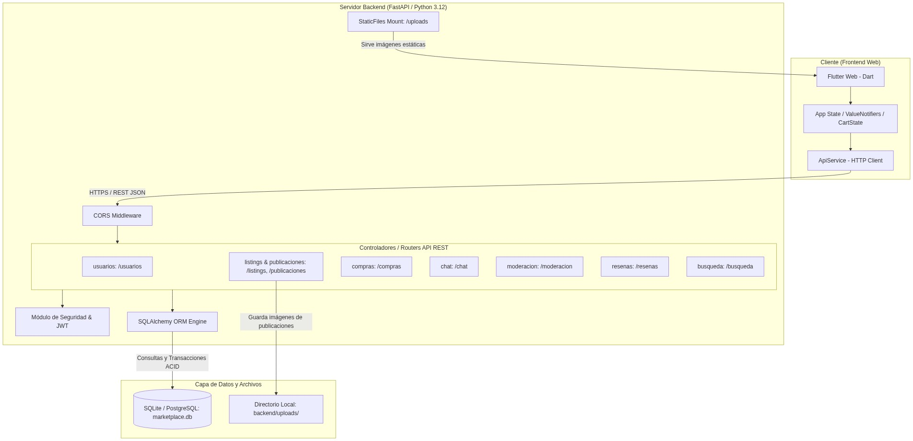
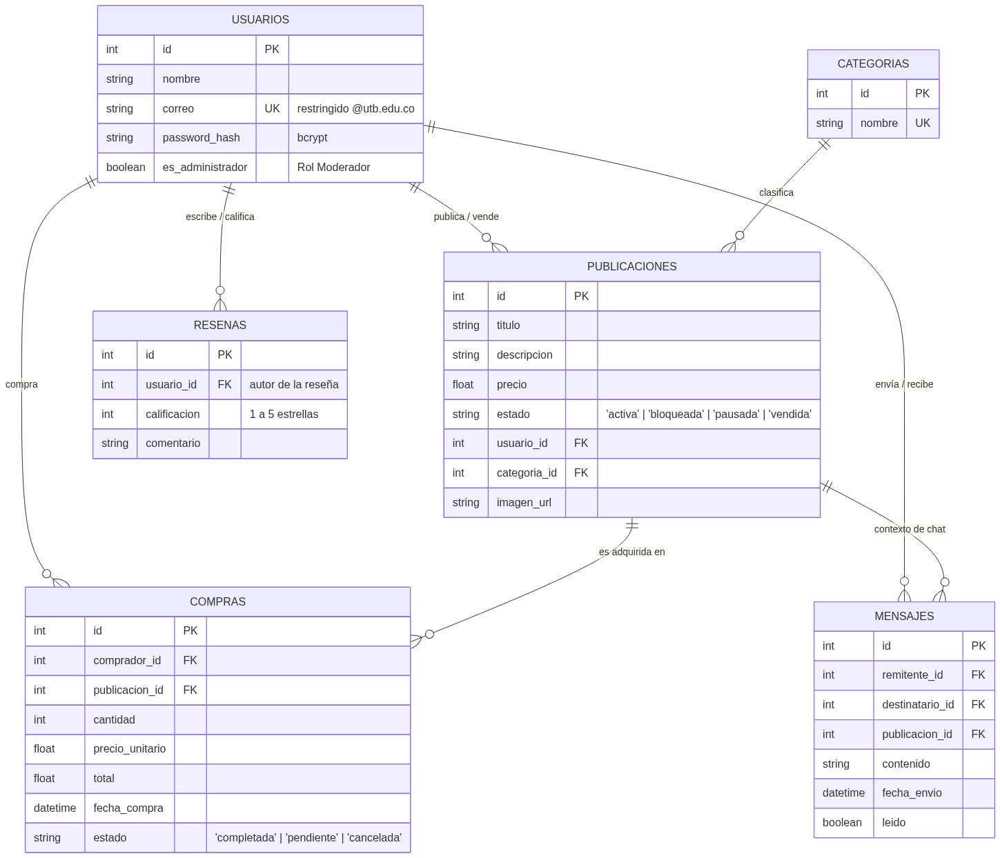
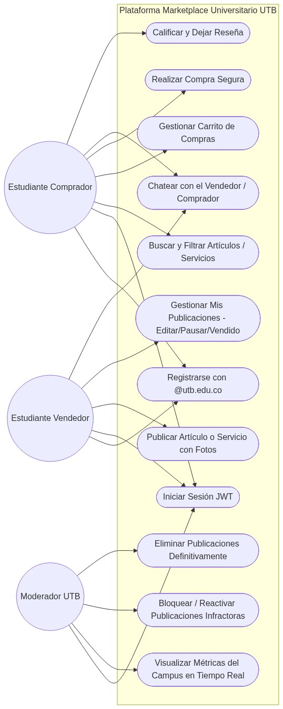
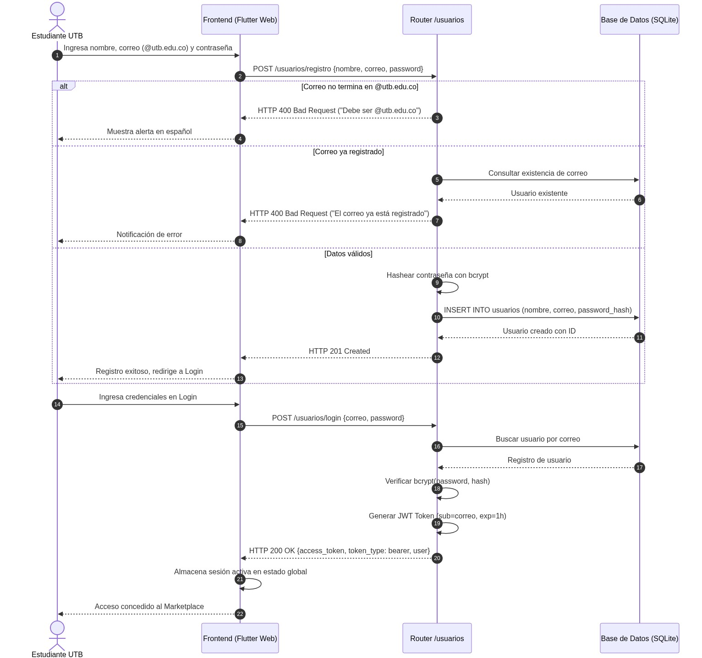
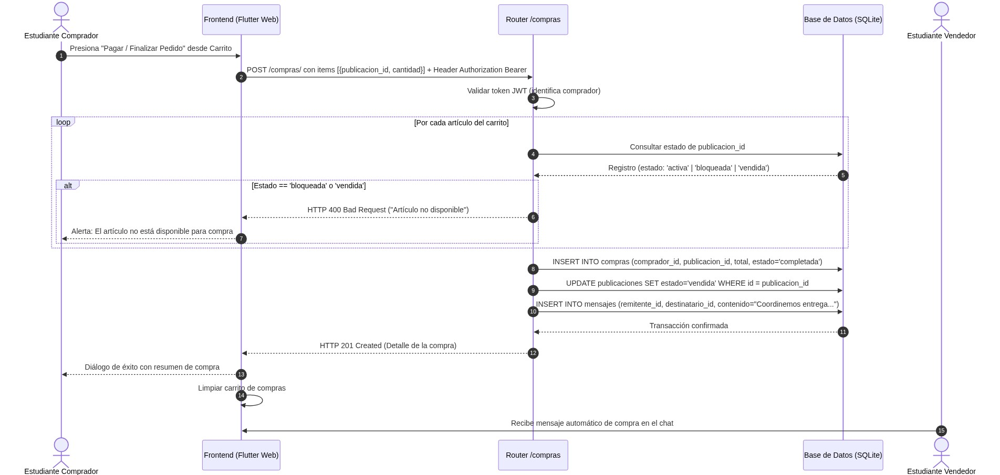
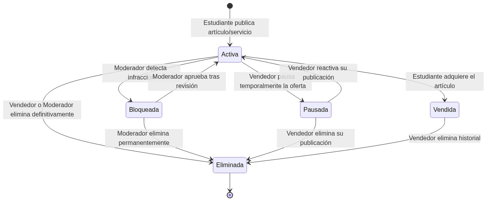

# Documentación de Arquitectura y Diagramas del Sistema — Marketplace Universitario UTB

Este documento describe de forma detallada el modelado arquitectónico, estructural y de comportamiento de la plataforma **Marketplace Universitario UTB**, haciendo referencia directa a las imágenes renderizadas en el directorio [`./renders/`](./renders/).

---

## Índice de Diagramas y Matriz de Trazabilidad

| # | Diagrama | Archivo en `renders/` | Requerimientos Asociados | Módulos Principales Relacionados |
| :-: | :--- | :--- | :--- | :--- |
| **1** | [Arquitectura y Componentes (C4 / Capas)](#1-diagrama-de-arquitectura-y-componentes-c4--capas) | [`01_arquitectura_c4.png`](./renders/01_arquitectura_c4.png) | `RNF-01`, `RNF-02`, `RNF-03` | `frontend/lib/`, `backend/app/main.py`, `backend/uploads/` |
| **2** | [Modelo Entidad-Relación (DER)](#2-modelo-entidad-relación-der-de-base-de-datos) | [`02_modelo_entidad_relacion_der.png`](./renders/02_modelo_entidad_relacion_der.png) | `RF-01` a `RF-09` | `backend/app/models/`, `backend/app/database.py` |
| **3** | [Diagrama de Casos de Uso (UML)](#3-diagrama-de-casos-de-uso-uml) | [`03_casos_de_uso_uml.png`](./renders/03_casos_de_uso_uml.png) | `RF-01` a `RF-09` | Todos los routers API y pantallas en `frontend/lib/screens/` |
| **4** | [Secuencia: Registro y Autenticación JWT](#4-diagrama-de-secuencia-registro-institucional-y-autenticación-jwt) | [`04_secuencia_autenticacion_jwt.png`](./renders/04_secuencia_autenticacion_jwt.png) | `RF-01`, `RNF-02` | `backend/app/routers/usuarios.py`, `login.dart`, `register.dart` |
| **5** | [Secuencia: Compra Segura y Chat Automático](#5-diagrama-de-secuencia-compra-segura-moderación-y-chat-automático) | [`05_secuencia_compra_segura.png`](./renders/05_secuencia_compra_segura.png) | `RF-05`, `RF-08`, `RF-09` | `backend/app/routers/compras.py`, `chat.py`, `cart_dialog.dart` |
| **6** | [Estados: Ciclo de Vida de una Publicación](#6-diagrama-de-estados-ciclo-de-vida-de-una-publicación) | [`06_estados_ciclo_vida_publicacion.png`](./renders/06_estados_ciclo_vida_publicacion.png) | `RF-02`, `RF-03`, `RF-07`, `RF-09` | `publicaciones.py`, `moderacion.py`, `listings.py` |

---

## 1. Diagrama de Arquitectura y Componentes (C4 / Capas)

> **Archivo fuente de imagen:** [`renders/01_arquitectura_c4.png`](./renders/01_arquitectura_c4.png)

### Explicación Arquitectónica
El sistema implementa una arquitectura **Cliente-Servidor desacoplada por capas**, comunicada mediante peticiones `HTTPS / REST JSON`:

1. **Cliente (`Frontend Web — Flutter / Dart`):**
   - **Interfaz Responsiva (`Flutter Web - Dart`):** Construida con Material 3 e identidad institucional UTB, adaptable tanto a escritorio como a navegadores móviles verticales.
   - **Gestión de Estado Reactivo (`App State / ValueNotifiers / CartState`):** Administra en memoria la sesión activa (`AuthSession`), el carrito de compras (`CartState`), las notificaciones/alertas de mensajes no leídos (`NotificationState`) y la sincronización periódica del catálogo sin necesidad de recargar la página.
   - **Cliente HTTP (`ApiService`):** Centraliza las llamadas REST hacia el backend adjuntando tokens `Bearer JWT` y resolviendo URLs de imágenes estáticas.

2. **Servidor Backend (`FastAPI / Python 3.12`):**
   - **`CORS Middleware`:** Gestiona el control de acceso entre orígenes y cabeceras HTTP para el consumo seguro desde el cliente web.
   - **Controladores / Routers API REST:** División modular por dominio funcional:
     - `/usuarios`: Registro institucional `@utb.edu.co` e inicio de sesión.
     - `/listings` y `/publicaciones`: Consulta pública del catálogo, subida de fotografías y gestión de publicaciones propias del vendedor.
     - `/compras`: Procesamiento transaccional del carrito y validación de elegibilidad de compra.
     - `/chat`: Mensajería bidireccional aislada por publicación `(otro_usuario_id, publicacion_id)`.
     - `/moderacion`: Estadísticas en tiempo real, bloqueo, reactivación y eliminación de contenido infractor.
     - `/resenas`: Calificaciones de reputación (1 a 5 estrellas) y comentarios entre estudiantes.
     - `/busqueda`: Motor de búsqueda flexible/difusa tolerante a errores tipográficos y tildes.
   - **Módulo de Seguridad & JWT:** Encriptación irreversible de contraseñas con `bcrypt` y emisión/verificación de tokens firmados con `HS256`.
   - **`SQLAlchemy ORM Engine`:** Capa de abstracción de datos encargada de ejecutar consultas parametrizadas y transacciones ACID.
   - **`StaticFiles Mount (/uploads)`:** Expone públicamente las fotografías cargadas para las ofertas estudiantiles.

3. **Capa de Datos y Archivos:**
   - **Base de Datos Relacional (`marketplace.db` en SQLite / PostgreSQL en producción):** Almacena todas las entidades persistentes del negocio.
   - **Directorio Local (`backend/uploads/`):** Repositorio físico de imágenes subidas con identificadores únicos UUID.

---

## 2. Modelo Entidad-Relación (DER) de Base de Datos

> **Archivo fuente de imagen:** [`renders/02_modelo_entidad_relacion_der.png`](./renders/02_modelo_entidad_relacion_der.png)

### Descripción de Entidades y Relaciones
El esquema relacional garantiza integridad referencial mediante claves primarias (`PK`), foráneas (`FK`) y restricciones de unicidad (`UK`):

- **`USUARIOS`:** Representa a los miembros autenticados de la comunidad universitaria.
  - Atributos clave: `id` (`PK`), `nombre`, `correo` (`UK`, restringido a `@utb.edu.co`), `password_hash` (`bcrypt`), `es_administrador` (define privilegios de **Moderador**).
- **`CATEGORIAS`:** Catálogo normalizado de categorías del marketplace (`Libros y Apuntes`, `Electrónica`, `Servicios Académicos`, `Transporte y Rides`, etc.) con `id` (`PK`) y `nombre` (`UK`). Relación `1:N` (*clasifica*) hacia `PUBLICACIONES`.
- **`PUBLICACIONES`:** Ofertas de productos o servicios creadas por un estudiante vendedor (`usuario_id` `FK`) dentro de una categoría (`categoria_id` `FK`).
  - Incluye `titulo`, `descripcion`, `precio`, `imagen_url` y `estado` (`'activa'`, `'bloqueada'`, `'pausada'`, `'vendida'`, `'eliminada'`).
- **`COMPRAS`:** Registra las adquisiciones realizadas por un estudiante comprador (`comprador_id` `FK`) sobre una publicación (`publicacion_id` `FK`), almacenando `cantidad`, `precio_unitario`, `total`, `fecha_compra` y `estado` (`'completada'`, `'pendiente'`, `'cancelada'`).
- **`MENSAJES`:** Modela la mensajería directa entre estudiantes (`remitente_id` `FK` y `destinatario_id` `FK`) vinculada al contexto específico de una oferta mediante `publicacion_id` (`FK`), además de `contenido`, `fecha_envio` y bandera booleana `leido`. Esta clave foránea `publicacion_id` permite aislar conversaciones independientes por cada publicación incluso con un mismo vendedor.
- **`RESENAS`:** Almacena las valoraciones de confianza (`1 a 5 estrellas` y `comentario`) emitidas entre usuarios tras la interacción en la plataforma.

---

## 3. Diagrama de Casos de Uso (UML)

> **Archivo fuente de imagen:** [`renders/03_casos_de_uso_uml.png`](./renders/03_casos_de_uso_uml.png)

### Actores y Funcionalidades dentro de la Frontera del Sistema
El diagrama delimita las capacidades de los **tres roles principales** dentro de la **Plataforma Marketplace Universitario UTB**:

1. **Estudiante Comprador:**
   - *Registrarse con `@utb.edu.co`* e *Iniciar Sesión JWT*.
   - *Buscar y Filtrar Artículos / Servicios* por categoría o texto difuso.
   - *Gestionar Carrito de Compras* (agregar artículos, ajustar cantidades, vaciar).
   - *Realizar Compra Segura* (sujeta a sesión activa y validación de estado de la publicación).
   - *Chatear con el Vendedor / Comprador* en un hilo dedicado por artículo para acordar entrega en el campus.
   - *Calificar y Dejar Reseña* al oferente del servicio/producto.

2. **Estudiante Vendedor:**
   - Comparte el flujo de autenticación institucional (*Registrarse con `@utb.edu.co`* e *Iniciar Sesión JWT*) y exploración del catálogo.
   - *Publicar Artículo o Servicio con Fotos* asignando título, categoría, precio e imagen.
   - *Gestionar Mis Publicaciones (Editar / Pausar / Vendido / Eliminar)* controlando la disponibilidad de su inventario.
   - *Chatear con el Vendedor / Comprador* recibiendo alertas y mensajes en tiempo real de interesados.

3. **Moderador UTB:**
   - Requiere *Iniciar Sesión JWT* con cuenta administrativa (`es_administrador = True`).
   - *Visualizar Métricas del Campus en Tiempo Real* (total de publicaciones, activas, bloqueadas/pausadas y usuarios registrados).
   - *Bloquear / Reactivar Publicaciones Infractoras* impidiendo su compra mientras estén bloqueadas.
   - *Eliminar Publicaciones Definitivamente* retirándolas de inmediato del catálogo visible.

---

## 4. Diagrama de Secuencia: Registro Institucional y Autenticación JWT

> **Archivo fuente de imagen:** [`renders/04_secuencia_autenticacion_jwt.png`](./renders/04_secuencia_autenticacion_jwt.png)

### Flujo Paso a Paso (`Pasos 1 al 22`)
Representa las interacciones temporales entre **Estudiante UTB**, **Frontend (Flutter Web)**, **Router `/usuarios`** y **Base de Datos (SQLite)**:

- **Fase de Registro (`Pasos 1–13`):**
  1. El estudiante ingresa nombre, correo institucional y contraseña en el formulario (`Paso 1`), enviando `POST /usuarios/registro` (`Paso 2`).
  2. El router evalúa tres caminos mutuamente excluyentes (`alt`):
     - **Correo fuera del dominio `@utb.edu.co` (`Pasos 3–4`):** Rechaza inmediatamente con `HTTP 400 Bad Request` y muestra alerta clara en español sin tocar la base de datos.
     - **Correo duplicado (`Pasos 5–8`):** Consulta en base de datos, detecta registro previo y responde `HTTP 400 Bad Request` (*"Ya existe un usuario registrado con ese correo"*).
     - **Datos válidos (`Pasos 9–13`):** Genera el hash seguro con `bcrypt`, ejecuta `INSERT INTO usuarios`, retorna `HTTP 201 Created` (sin exponer la contraseña) y redirige al inicio de sesión.

- **Fase de Autenticación (`Pasos 14–22`):**
  1. El estudiante envía sus credenciales mediante `POST /usuarios/login` (`Pasos 14–15`).
  2. El backend recupera el usuario por correo (`Pasos 16–17`), verifica `bcrypt(password, password_hash)` (`Paso 18`) y firma un `JWT Token` con el correo en el claim `sub` y tiempo de expiración (`Paso 19`).
  3. Responde `HTTP 200 OK` con `{access_token, token_type: "bearer", usuario}` (`Paso 20`), el frontend guarda la sesión activa en `authSession` (`Paso 21`) y habilita las funciones protegidas del marketplace (`Paso 22`).

---

## 5. Diagrama de Secuencia: Compra Segura, Moderación y Chat Automático

> **Archivo fuente de imagen:** [`renders/05_secuencia_compra_segura.png`](./renders/05_secuencia_compra_segura.png)

### Flujo Transaccional Paso a Paso (`Pasos 1 al 15`)
Modela la protección contra compras no autorizadas o sobre publicaciones restringidas por moderación, así como la conexión inmediata entre comprador y vendedor:

1. **Solicitud Autenticada (`Pasos 1–3`):** El comprador confirma su pedido desde el carrito; el frontend envía `POST /compras/` con la lista `[{publicacion_id, cantidad}]` y la cabecera `Authorization: Bearer <token>`. El router valida el JWT identificando al comprador (si no hay token válido, rechaza con `HTTP 401`).
2. **Validación Previa por Ítem (`Pasos 4–7`, bloque `loop` + `alt`):** Por cada artículo del carrito se consulta su estado actual en base de datos. Si el estado es `'bloqueada'` (por un moderador) o `'vendida'` / no activa, la operación se cancela con `HTTP 400 Bad Request` notificando al comprador qué artículo impide el pago.
3. **Persistencia Atómica y Enlace por Chat (`Pasos 8–11`):**
   - `Paso 8`: Inserta el registro en `compras` con `estado='completada'` y cálculo del total.
   - `Paso 9`: Actualiza automáticamente la publicación a `estado='vendida'` para impedir ventas duplicadas.
   - `Paso 10`: Inserta automáticamente un registro en `mensajes` asociando `remitente_id`, `destinatario_id` y `publicacion_id` para abrir el canal de coordinación de entrega en el campus Ternera.
4. **Confirmación en Interfaz y Notificación al Vendedor (`Pasos 12–15`):** El backend retorna `HTTP 201 Created`, el frontend limpia `CartState`, presenta el diálogo de confirmación con acceso directo al hilo de chat de esa publicación y el **Estudiante Vendedor** recibe el mensaje entrante de forma reactiva sin necesidad de refrescar el navegador.

---

## 6. Diagrama de Estados: Ciclo de Vida de una Publicación

> **Archivo fuente de imagen:** [`renders/06_estados_ciclo_vida_publicacion.png`](./renders/06_estados_ciclo_vida_publicacion.png)

### Máquina de Estados Finitos y Reglas de Transición
Toda oferta dentro de **UTB Market** transita de manera controlada entre cinco estados bien definidos:

- **`Activa` (Estado inicial tras publicar):** La oferta es visible en su categoría y en el buscador, permite iniciar hilos de chat independientes y puede agregarse al carrito de compras.
- **`Bloqueada` (Control de Moderación):**
  - *Entrada:* El moderador detecta una infracción desde el Panel de Moderación (`Activa → Bloqueada`).
  - *Efecto:* Muestra advertencia visual de bloqueo e **impide estrictamente su compra** tanto en interfaz como en el endpoint `/compras/`.
  - *Salida:* Puede volver a `Activa` si el moderador la aprueba tras revisión (`Bloqueada → Activa`) o pasar a `Eliminada`.
- **`Pausada` (Gestión del Vendedor):**
  - *Entrada/Salida:* El propio vendedor pausa temporalmente su oferta desde *Mis Publicaciones* (`Activa → Pausada`) y puede reactivarla cuando vuelva a tener disponibilidad (`Pausada → Activa`). Mientras está pausada no admite compras.
- **`Vendida` (Cierre de Transacción):**
  - *Entrada:* Se alcanza automáticamente cuando un estudiante completa la compra en `/compras/` o manualmente cuando el vendedor la marca como vendida (`Activa → Vendida`). Queda protegida contra recompras duplicadas.
- **`Eliminada` (Estado final `[*]`):**
  - *Entrada:* Alcanzable desde `Activa`, `Bloqueada`, `Pausada` o `Vendida` cuando el vendedor retira su publicación (borrado lógico `estado='eliminada'`) o cuando el moderador la elimina definitivamente (`DELETE /moderacion/publicaciones/{id}`).
  - *Efecto:* Desaparece de inmediato del catálogo público (`/listings/`, `/busqueda/`) y de la vista activa sin requerir recarga manual de la página.
