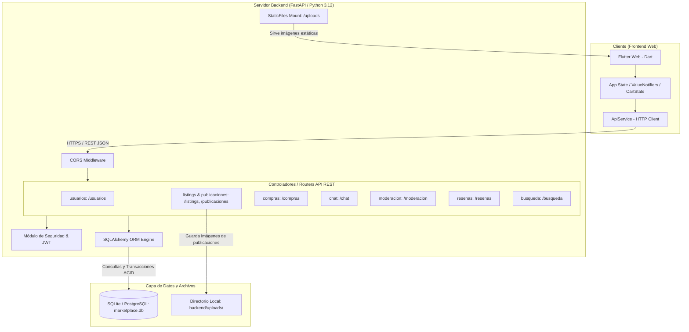
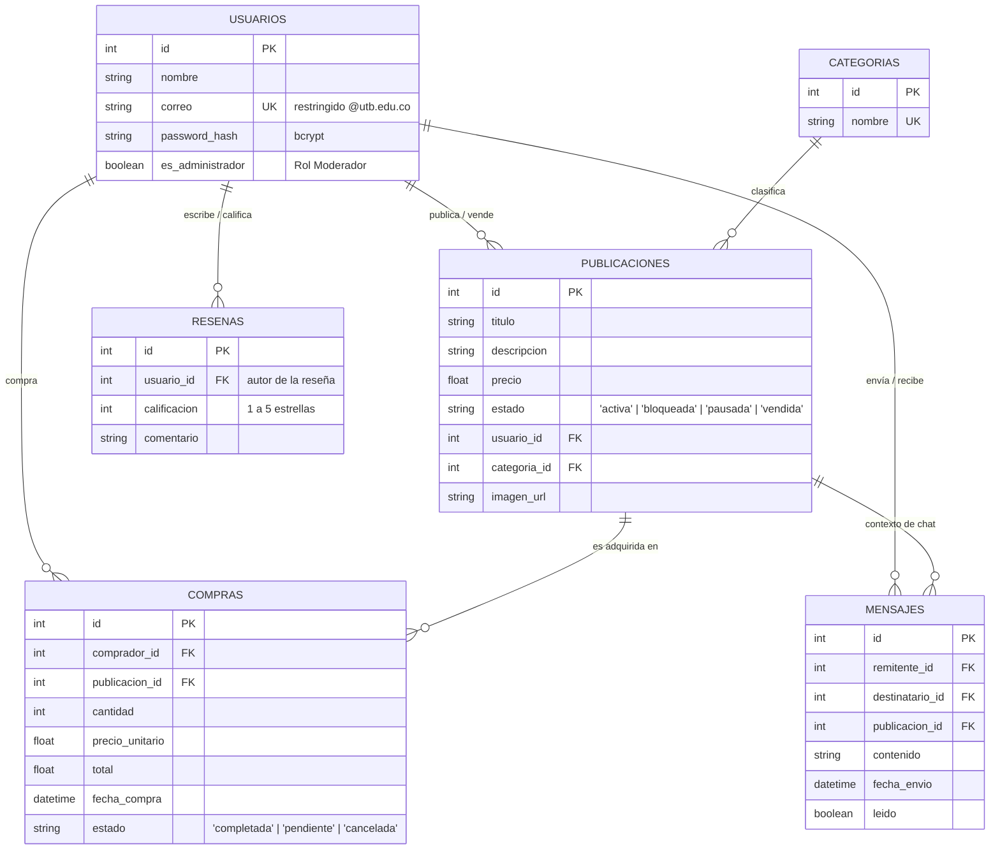
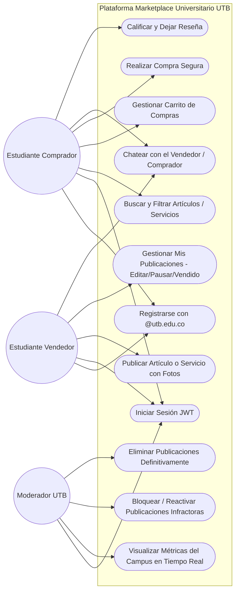
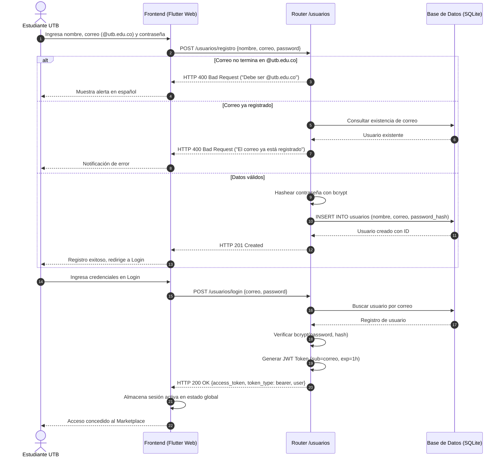
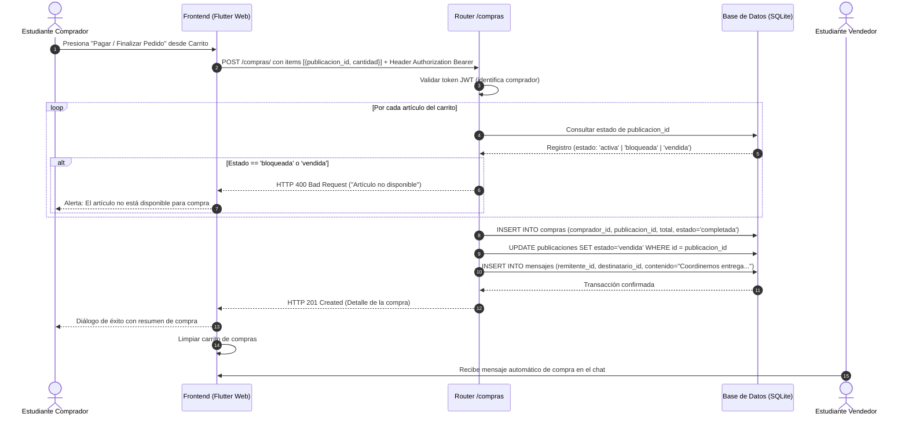
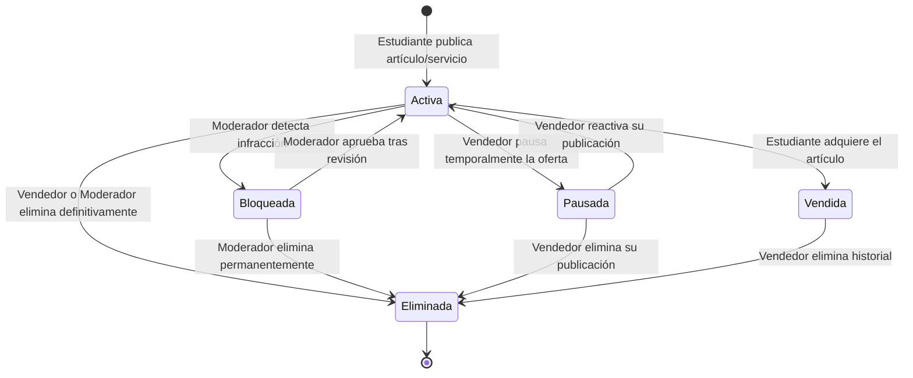

# Diagramas de Arquitectura, Diseño y Modelado del Sistema
## Marketplace Universitario UTB — Ingeniería de Software (2026-2)

Este documento contiene la especificación formal y visual del sistema mediante diagramas estándar (C4, UML, DER, Secuencia y Estados) implementados en **Mermaid**, facilitando su renderizado directo en GitHub, Visual Studio Code y herramientas de documentación.

---

## 1. Diagrama de Arquitectura y Componentes (C4 / Capas)

Muestra la separación de responsabilidades entre el cliente Flutter Web, el servidor FastAPI, el sistema de persistencia y el almacenamiento estático.

---

## 2. Diagrama Entidad-Relación (DER / Modelo de Base de Datos)

Representación física y relacional de los modelos ORM de la base de datos `marketplace.db`:

---

## 3. Diagrama de Casos de Uso (UML)

Muestra las funcionalidades disponibles según el rol del actor en la plataforma universitaria.

---

## 4. Diagrama de Secuencia: Registro y Autenticación Segura (RF-01)

Validación estricta de correo institucional y emisión de token JWT cifrado con clave secreta:

---

## 5. Diagrama de Secuencia: Compra Segura y Validación de Moderación (RF-05 & RF-08)

Proceso que garantiza que artículos bloqueados por moderación no sean adquiridos, registra la transacción y abre la coordinación en el chat:

---

## 6. Diagrama de Estados: Ciclo de Vida de una Publicación

